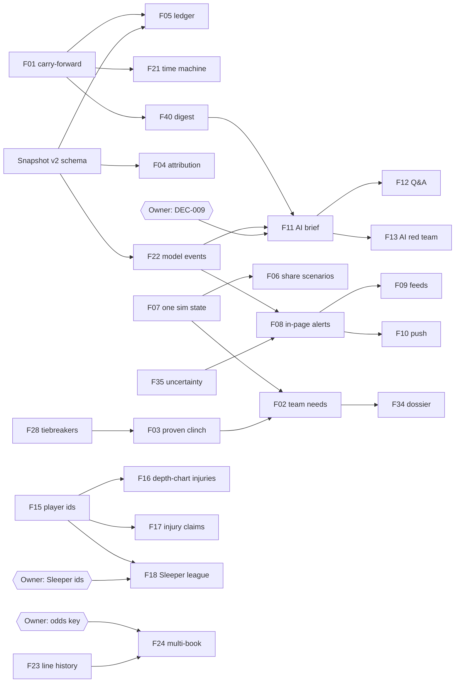

# Feature research

> Living document. First written Nov. 23, 2026. Future research sessions read this file, `FEATURE_BACKLOG.md` and `FEATURE_ROADMAP.md` first, check what was built since, re-score what changed, and add to the history at the bottom instead of regenerating.
>
> Evidence labels used throughout: **[repo]** seen in this repository's code or data; **[probed]** a real request made on Nov. 23, 2026; **[docs]** read on the provider's own page that day; **[search]** from search summaries only (weaker); **[judgment]** our own reasoning, not evidence.

## Contents
1. Project baseline · 2. Current capabilities · 3. Architecture summary · 4. Competitor research · 5. GitHub research · 6. Technology research · 7. Feature gap matrix · 8. Feature candidates · 9. Scoring · 10. Top 20 · 11. Top 5 game changers · 12. Automation opportunities · 13. AI opportunities · 14. Data opportunities · 15. Dependencies · 16. Roadmap · 17. Rejected and deferred · 18. Sources · 19. Open questions · 20. Next research tasks

---

## 1. Project baseline

**What it is.** A free, non-commercial NFL fan project. It began as a pick-the-games playoff simulator and now opens on "NFL Universe", a command center in the style of World Monitor. It is one static HTML page built by stdlib Python, plus a Node server with no dependencies and a read-only MCP server. `main` is at `b005ba2` (Nov. 23, 2026). [repo]

**How it is built and run.**
- Plain JavaScript, no framework, no npm packages (DEC-001). Python stdlib for the build; numpy only for offline evaluation.
- About 9,600 lines of source. The built page is about 480 KB.
- Four test suites run under `npm test`: engine and feed parser, about 40 fabric tests, 4 MCP tests, and over 200 command-center checks plus 128 layout checks.

**How data arrives.**
- A daily scheduled refresh (a Claude scheduled task, author "Claude") rebuilds the data, runs the tests, saves a snapshot and commits to `main`.
- FantasyPros has a GitHub Action that has never run.
- Render hosting is prepared but not deployed (DEC-018).

**Who uses it.** The owner, plus anyone the published page is shared with. There are no accounts and no personal data. Personalization is URL state plus `localStorage`.

**Existing strengths** (evidence that competitors lack these is in §4):
- Honest modelling: a point-in-time backtest, a published calibration table, "Popular claims, tested", and the house rule of no factor without an out-of-sample gain.
- Provenance everywhere: every event carries `ts` and `seenAt`, source, tier, confidence and corroboration count. A source-health panel shows staleness instead of blank panels.
- A per-news-item playoff effect, computed from the line move times the team's conditional playoff gap (`newsEffect`, `simulate(..., watch)`). No competitor found does this.
- Model-against-market shown per game, with a "Why? What could be wrong?" panel computed from inputs.
- Resilient fabric: breakers, last-good caches, and public and local scopes kept apart (DEC-006).

**Existing weaknesses** (with evidence):

| Area | Weakness | Evidence |
|---|---|---|
| Reliability | The Nov. 23 refresh published a degraded snapshot (Open-Meteo, both RSS feeds, YouTube and podcasts all `fetch failed`, from a container without open internet) and overwrote the previous good one. There is no event file for Nov. 22. The published page lost headlines, weather and media | [repo] `data/fabric/latest.json` sources; `data/fabric/events/` |
| Reliability | `/api/live` has no fetch timeout and re-fetches on every request while ESPN is down | [repo] `server.js` `liveGames()` |
| Reliability | The simulator's live poll has no timeout, and after one success it polls forever | [repo] `src/template.html` ~`:793-801` |
| Security | No Content-Security-Policy. `serveStatic` uses a prefix check with no path separator. The simulator's news link skips `safeUrl` (low risk: curated file) | [repo] |
| UX | Picks and the what-if live only in `localStorage`. No shareable scenario, one unnamed scenario per browser | [repo] `template.html:510-522` |
| UX | The two views compute different odds for the same moment: the simulator uses picks, what-if and live scores; the command center uses feed finals only. Neither shares picks | [repo] `03-sim.js:96-113` |
| UX | Clinch flags are conservative sufficient conditions. There are no "needs X to clinch" scenarios | [repo] `status()`; CLAUDE.md |
| Hidden value | The engine's `watch` (conditional playoff odds per game outcome) drives only the brief's "most important game" and the game drawer. There is no per-team "games that matter" view | [repo] |
| Hidden value | Computed but never shown: `D.history.dv`, `D.prev.division`/`superBowl`, `report.bySeason`/`disagreement`, `monteCarloMargin95`, injury `practice`/`returnDate`/`also`, moneylines | [repo] |
| Hidden value | The "Model" feed filter is always empty: the fabric never emits `model` or `playoff_move` events, although the contract defines them | [repo] `lib/contract.js:7` |
| Data | Snapshots do not store per-game model probabilities, a model version, or which results were in. So this season's forecasts cannot be scored, and "what changed" cannot be split into causes | [repo] `scripts/snapshot.js` |
| Data | No canonical player ids; no official (tier-1) news source; no futures source | [repo]; registry |
| Automation | `data/news.json` is maintained by the daily Claude run by hand. Nothing alerts anyone; nothing publishes a digest | [repo] |
| Consistency | Line-move thresholds differ: simulator 0.03, MCP 0.02, fabric 1.5 spread points, map label 0.005. Fumble-luck threshold is 8 in the simulator and 5 in `proveWrong` | [repo] |
| Tech debt | `evaluate.py` re-declares the build's constants; `backtest.py` has its own ridge fit. No DOM-level tests of the page | [repo]; audits |

**Unfinished work** (no TODO/FIXME comments in code; unfinished work shows up as disabled UI and unused fields):
- Disabled UI: "Network · soon" and "Schedule · soon" map modes, and the "History (later phase)" time range (`15-shell.js:108-111`).
- Never run: the FantasyPros workflow (`data/fantasypros/` holds only `.gitkeep`), so `D.fp` is effectively off.
- Dead code: `openLive` in the simulator.
- Unused endpoints: `/api/team/<abbr>`, `/api/health`, `?since=` on `/api/universe`.
- Unused file: `data/qb_holdout_report.json`.
- Planned in `MASTER_PLAN.md`: M4 (model validation), M5 (intelligence depth), M6 (live game center), M7 (AI assistant), M9 (hardening).

## 2. Current capabilities (inventory)

Full inventory: subagent report, Nov. 23, 2026, summarised here.

- **Simulator view (`?view=sim`):**
  - Picks per game, "pick favorites this week", three odds modes.
  - Seed distribution, final-record histogram and playoff chance by week.
  - Round-by-round odds and Super Bowl favourites.
  - Standings with clinch flags; playoff picture today and projected.
  - Seed grid, remaining strength of schedule, draft order with traded picks.
  - Model report, "Popular claims, tested", what-changed card, news ticker with per-item effect.
  - What-if strength slider, sensitivity check, live polling of `/api/live`.
- **Command center:**
  - 3 map modes (geographic, divisions, intelligence) and 18 layers.
  - Intelligence feed with type filters and 9 time ranges; search; focus bar (league, conference, division, team); URL state.
  - Team drawer and game drawer (with local win-probability chart and scoring plays); games strip; ticker; source health.
  - Rule-based brief (10 findings, see §13); simulation in a Web Worker (20,000 seasons; deep run 100,000).
  - Movable, resizable panels; phone tabs.
- **Media:** official NFL and 32 team YouTube channels, click-to-load; live-page links; six official NFL podcasts; fallback to links where the host blocks players.
- **Data fabric:**
  - Sources: nflverse schedule, lines and injuries; Open-Meteo; ESPN and Yahoo RSS; curated news; YouTube and podcast feeds. Locally only: ESPN scoreboard, news, injuries, transactions and game summaries.
  - Machinery: breakers, last-good caches, a game-window heartbeat (Nov. 23), honest event times, headline clustering, injury cross-source comparison.
- **MCP server:** 14 read-only tools, including `run_simulation` (all-team diff) and `get_what_changed`, which have no UI equivalent.
- **Offline evaluation:** point-in-time backtest 2021–2025, calibration, analogs, narrative tests, QB hold-out.

## 3. Architecture summary

```
nflverse · nfelo · data/*.json ─► scripts/build.py ─► D (incl. D.fabric snapshot) ─► public/index.html
                                                                                   ├ engine (pure: simulate, ratings, watch)
lib/fabric (adapters → source.js breaker/cache → index.js events/injuries/media)   ├ simulator view
   ├► server.js  /api/universe /api/health /api/game /api/team /api/live           └ command center (src/universe/*)
   ├► mcp/server.js (stdio, 14 read-only tools; loads the page's engine)
   └► scripts/fabric-snapshot.js ─► data/fabric/latest.json + events/<day>.json
scripts/snapshot.js ─► data/snapshots/<day>.json        scripts/evaluate.py ─► data/model_report.json
Scheduling: local/cloud Claude task (daily refresh) · GitHub Actions (FantasyPros, never run) · server heartbeat
```

| Concern | Today |
|---|---|
| Frontend | One static page, modules concatenated at build, Web Worker simulation |
| Backend and API | Dependency-free Node server; Host allowlist, rate limit; ESPN local-only |
| Database | None: flat JSON (snapshots, daily event files, caches) |
| Auth | None |
| External services | nflverse, nfelo, Open-Meteo, ESPN/Yahoo RSS, YouTube/Omny feeds; ESPN JSON locally |
| Background jobs | Daily refresh; server heartbeat during game windows |
| AI | None in the product (DEC-009); MCP server for the owner's own agents |
| Caching | Per-source TTL, stale-while-revalidate, last-good on disk; 5-second payload memo |
| Monitoring | `/api/health` and the System Health panel; no alerting, no drift checks |

## 4. Competitor research

From the competitor stream. Products checked: ESPN Playoff Machine/FPI, NYT Upshot (memory only: site blocked), A to Z Sports Playoff Predictor, Stick to the Model, PFN Playoff Meter, PlayoffStatus, Harvey Mudd Playoff Probabilities, Silver Bulletin ELWAY, nfelo, PFF, SumerSports/SumerBrain, nflseedR-based sites, Sleeper, RotoWire/RotoBaller, Action Network, OddsJam, Kalshi/Polymarket, STACKED, the NFL app/NFL Pro/NFL IQ, ESPN with IBM watsonx, Yahoo, Google AI Mode, Perplexity Sports.

**Main findings**
- **The simulator itself is crowded.** ESPN, A to Z, Stick to the Model and PFN all offer pick-the-games plus Monte Carlo plus tiebreakers plus draft odds.
  - A to Z also publishes calibration buckets and shares images; nfelo publishes a full performance history [docs].
  - So "we have a simulator with a backtest" is **not** a differentiator.
- **Probably distinctive** (moderate confidence):
  - per-news-item playoff effect;
  - switchable odds sources with a sensitivity check;
  - corroboration and confidence on news;
  - a visible source-health panel;
  - the per-game "what could be wrong" panel;
  - the map command center;
  - an MCP server;
  - free with no betting affiliate links.
- **What users value that we lack:**
  - fast, trustworthy alerts (Sleeper's ratings rest on alert speed; the most common complaint elsewhere is late or missing inactive alerts) [search];
  - fantasy-league sync;
  - a conversational assistant (now table stakes at NFL, ESPN/IBM, Yahoo and Google);
  - multi-book odds and line alerts (paid at Action Network PRO and OddsJam);
  - shareable images;
  - player pages.
- **AI failures are the norm, and documented** [docs/search]:
  - Grok posted a "final" score mid-game (Oct. 2025).
  - A Google app published an invented Eagles result before kickoff (Dec. 2025).
  - Gemini and Copilot invented Super Bowl stats (Feb. 2024).
  - An analyst repeated a wrong ChatGPT stat on air (Jan. 2026).
  - All relied on small-print disclaimers. NFL IQ instead limits answers to the league's own data.

**Unmet needs: nobody does these well.** This is where differentiation lies.
1. **"What does my team need?"** A plain-language minimum path, most-likely path, and games to root for ranked by impact, updated as you pick. A to Z and the NYT come closest; PFN and NFL.com cover this week's clinch scenarios only.
2. **Why the odds moved.** A split into own result, rivals' results, rating change, and news or quarterback change. ESPN narrates after the fact; Silver's conditional odds are paywalled.
3. **Live public accuracy tracking of season-level odds** ("we said 70%; it happened X%"). nfelo tracks game picks only; A to Z's backtest is static.
4. **Model against market, with reasons, for playoff odds.** Nobody does it per team. Prediction-market prices exist, but their terms block us (§6, §17).
5. **Provenance and conflict handling for injuries and news.** Injury news is syndicated (RotoWire to Sleeper, ESPN, Yahoo). No app shows "reported by X, unconfirmed, conflicts with the official report".
6. **Alert quality.** Users complain both of late alerts and of "WAY too many". Controls are per player, never "only if it moves my team's odds by N points".
7. **AI answers grounded in data, with refusal on unknowns** and a freshness stamp on every answer.
8. **Time-machine replay** of what was known at a moment, without future leakage.
9. **Uncertainty communication.** A to Z's "a 70% team misses about three times in ten" is the best example found.

**Legal patterns seen:**
- A to Z disclaims logos and affiliation; Stick to the Model hotlinks ESPN logos (do not copy that).
- nfelo carries affiliate and "entertainment only" disclosures.
- Prediction markets label prices as market-implied and publish their resolution rules.

## 5. GitHub research

New projects beyond `GITHUB_RESEARCH.md`. Stars, licences and push dates are from `gh api` calls on Nov. 23, 2026. Reuse key: GPL and AGPL code are reference only (the page is distributed as a static file).

| Project | Licence | Stars / push | Value here | Use |
|---|---|---|---|---|
| [nflverse/nflseedR](https://github.com/nflverse/nflseedR) `nfl_clinching_status()` (dev 2.0.2.9007) | MIT | 35 / 2026-11-16 | Clinch and elimination solver for division, berth and No. 1 seed, with proof scenarios. NEWS says it matches official flags every week 2006–2025. Also documents tiebreaker rule fixes worth comparing with our engine | Port the method with attribution and test against its outputs (F03, F28) |
| nflverse `players.csv` + `roster_2026.csv` | data CC-BY-4.0 | – | A permissive player-id crosswalk (`gsis`, `espn`, `sleeper`, `pfr`, `pff`, `yahoo` ids and more). Removes the need for the GPL dynastyprocess file | Integrate the data (F15) |
| [nflverse/nflverse-players](https://github.com/nflverse/nflverse-players) | MIT / data CC-BY | 5 / 2026-11-01 | A manual id-override file and a duplicate-id validator | Copy the pattern for unresolved matches |
| [ZachRit/nfl4th-js](https://github.com/ZachRit/nfl4th-js) | MIT (+NOTICE) | 0 / 2026-10-23 | TypeScript port of nflfastR expected points and win probability plus nfl4th, matching R within 1e-6 per its authors. Single commit, 88 MB of model JSON, not on npm | Server-only candidate for F19, after our own backtest |
| [nflverse/nfl4th](https://github.com/nflverse/nfl4th), [fastrmodels](https://github.com/nflverse/fastrmodels) | MIT | 25 / 9 | Fourth-down model and model weights; licence chain for the port above | Reference |
| [binwiederhier/ntfy](https://github.com/binwiederhier/ntfy) | Apache-2.0 / GPL-2.0 | 35.7k / 2026-11-23 | Push by plain HTTP POST; topic subscriptions, no accounts | Integrate over HTTP only (F10) |
| [draphy/pushforge](https://github.com/draphy/pushforge) | MIT | 67 / 2026-04-23 | Zero-dependency Web Push (VAPID and RFC 8291) on WebCrypto | Vendor with notice if Web Push is wanted (F10) |
| [chaoscondensate/forecast-ledger](https://github.com/chaoscondensate/forecast-ledger), [mverab/WorldCupBench](https://github.com/mverab/WorldCupBench) | Apache-2.0 / none | 6 / 15 | Sealed, timestamped forecast records; a live Brier leaderboard | Schema ideas for F05 |
| [frazane/scoringrules](https://github.com/frazane/scoringrules), [netcal](https://github.com/EFS-OpenSource/calibration-framework), [538 checking-our-work](https://github.com/fivethirtyeight/checking-our-work-data) | Apache / Apache / CC-BY | 110 / 381 / 31 | Proper scoring rules, ECE and reliability diagrams; the UX of a public "how good are our forecasts" page | Write the formulas ourselves with credit (F05) |
| [ebhattad/nfl-mcp](https://github.com/ebhattad/nfl-mcp) | MIT | 9 | nflverse to DuckDB to MCP; SQL over play-by-play | Reference for an analytics tool |
| [DanielTomaro13/sportsdata-mcp](https://github.com/DanielTomaro13/sportsdata-mcp) | MIT | 38 | About 860 tools over 66 providers | Cautionary example: keep our MCP small |
| [haotianxia/SportQA](https://github.com/haotianxia/SportQA) | CC-BY-4.0 | 12 | Sports-understanding benchmark (static knowledge) | Seed questions for an eval (F11, F12) |
| [mxufc29/nbainjuries](https://github.com/mxufc29/nbainjuries) | MIT | 48 | Parses the NBA's official injury PDFs | Not needed: nflverse `injuries` already parses the NFL report |
| [pmxt-dev/pmxt](https://github.com/pmxt-dev/pmxt), [Jon-Becker/prediction-market-analysis](https://github.com/Jon-Becker/prediction-market-analysis) | MIT | 2.2k / 4.0k | Normalizing and analysing prediction markets | Reference; the data terms are the blocker |
| [sjpagano/nfl-win-probability](https://github.com/sjpagano/nfl-win-probability), [kevinwelling12/football-app](https://github.com/kevinwelling12/football-app) | none | 1 / 0 | Browser win probability with out-of-time validation; a static soccer simulator with clinch proofs | Inspiration only (no licence) |

**No maintained open-source NFL news entity-linker or transaction parser exists.** The practical path is gazetteer matching against nflverse names plus aliases, which `lib/fabric/entities.js` already does for teams.

## 6. Technology research

All prices checked Nov. 23, 2026. Figures are estimates; measure with `count_tokens` on a real digest before deciding.

**Language models** (provider and ceiling are the owner's call, DEC-009):

| Workload (assumptions in the stream report) | Claude Haiku 5.5 ($0.10 / $0.50 per M) | Claude Sonnet 5.5 ($2 / $10) | Claude Opus 5.5 ($4 / $20) |
|---|---|---|---|
| Daily brief, 30 a month (about 17K in, 3K out) | ≈ $0.10/month | ≈ $1.90 (≈ $1 batched) | ≈ $3.80 |
| Hourly brief, 720 a month | ≈ $2.30 | ≈ $46 | ≈ $92 |
| Q&A, 50 a day (3 turns, about 20K in, 1.5K out) | ≈ $4 | ≈ $57–82 | ≈ $115–165 |

- Batch API is 50% off; caching reads are 0.05–0.1× input [docs].
- Structured outputs exist but **cannot be combined with citations** (400). So the design is structured output carrying `event_ids`, followed by a deterministic validator.
- Ids are validated after the answer, not put in an `enum`, because a per-call enum forces a schema recompile and breaks caching.
- OpenAI and Gemini have similar price points [docs]. Gemini's free tier uses submitted data to improve products, so not for user input.
- Local models (Ollama): no cost, but weaker at refusing unsupported claims. Fine for owner experiments only.

**Grounding pattern (recommended):**
1. Compact digest of events with ids; headlines passed as data in a field marked untrusted.
2. Structured output: `{sentences:[{text, kind: confirmed|reported|estimate|projection, event_ids}]}`.
3. A Node validator drops any sentence with an unknown or missing id, or with a number or team not found in the cited events.
4. Fall back to the rule-based brief, labelled as such.
5. Log the model id, prompt hash, input hash and token usage.
6. A small offline eval: 30–50 frozen payloads with conflicting sources and a planted false headline.

**RAG and vector search: not warranted.** A week of events is about 200K tokens and a season 3–5M. The current window fits one request, and questions are structured (team, date, type). Revisit only when the free-text corpus passes about 1M tokens, questions become paraphrase-style, and SQLite FTS5 measurably misses.

**Notifications without accounts:**
- RSS/Atom feeds and `.ics` schedules cost nothing and store nothing (high fit).
- ntfy topics: free; public topics on ntfy.sh, about 250 messages a day per visitor (medium-high fit).
- Web Push: needs a served origin, `sw.js` and stored subscriptions (personal data); on iPhone the site must be added to the Home Screen first. Fully doable with `node:crypto` (checked locally). Medium fit.
- Email: low fit (cost and personal data).

**Scheduling:**
- GitHub Actions cron: 5-minute minimum interval; delays and dropped runs at busy times; disabled after 60 days without repository activity. Good for the daily backup refresh and the brief.
- Render cron: from $1 a month. The free Render instance sleeps, so timers there are unreliable.
- Cloudflare Workers: a new runtime; reject for now.
- Game-window polling stays in the local server, which already has the heartbeat.

**Persistence:**
- Keep committed JSON/JSONL as the source of truth.
- Build a disposable `node:sqlite` index (Release Candidate in Node 24.15+, FTS5 works, checked locally) once queries span more than about 30 days or files pass about 50 MB.
- DuckDB: rejected (a dependency).

**Client features:**
- Web Share and canvas-drawn share cards: high fit.
- Service worker and installable app: only on a served origin; the claude.ai artifact host very likely forbids it (unverified).
- View Transitions: cosmetic.

**Speech and media:**
- YouTube `captions.download` needs the owner's OAuth, and YouTube's terms bar scraping, so no transcripts of team videos.
- Local Whisper-class transcription of podcasts is lower risk for private use. Store only short claims in our own words with an episode URL and timestamp; never the transcript.

**Anomaly detection and accuracy tracking:**
- Robust z-scores (median and MAD, |z| > 3.5) on line moves pooled over 3–4 weeks.
- CUSUM on forecast residuals against the market.
- Brier score, log loss and Brier skill score against the line; reliability tables with 5 bins (about 270 games a season).
- Freeze every forecast with a UTC time before kickoff.

## 7. Feature gap matrix

Matrix columns:
- **We have:** Yes, Partial, or No.
- **Competitors:** whether the best competitor does it well.
- **Opportunity:** how much we stand to gain.

| Feature | We have | Competitors | Opportunity | Priority |
|---|---|---|---|---|
| Pick-the-games simulator with tiebreakers and draft order | Yes | Yes (many) | Low (parity) | Maintain |
| Plain-language "what my team needs" and rooting guide | Partial (leverage colours, `watch`) | Partial (A to Z, NYT) | **High** | P0 |
| Proven clinch and elimination scenarios | Partial (conservative flags) | Partial (PFN, NFL.com weekly) | High | P1 |
| Why odds moved (attribution) | Partial (yesterday diff, news effect) | No | **High** | P0 |
| Public live accuracy tracker | No (static backtest) | Partial (nfelo, games only) | **High** | P0 |
| Alerts with significance thresholds | No | Partial (noisy per-player alerts) | **High** | P0 (in-page) / P1 (push) |
| Injury and news provenance and conflicts | Partial (fabric computes, UI hides) | No | High | P1 |
| Grounded AI brief and Q&A | No (rule brief, MCP) | Partial (ungrounded, failure-prone) | High | P1 (owner decision) |
| Shareable scenario links and images | No | Yes (A to Z, Stick to the Model) | Medium | P1 |
| Live playoff odds during games | Partial (simulator, local) | Yes (ESPN) | Medium | P1 |
| Uncertainty and simulation error shown | Partial | Partial | Medium | P1 |
| Tier-1 official news | No | Yes (team apps) | Medium | P1 |
| Fantasy league sync | No | Yes | Medium (owner decision, local only) | P2 |
| Player pages and depth charts | No | Yes | Medium | P2 |
| Multi-book odds and line history | No | Yes (paid) | Medium | P2 (needs a key) |
| Prediction-market comparison | No | Yes (markets themselves) | High value, **blocked by terms** | Deferred |
| Time-machine replay | No (placeholder) | No | High differentiation, high cost | P2 |
| Map command center and source health | Yes | No | Already ours | Maintain |
| Per-news playoff effect | Yes | No | Already ours: surface it more | (part of F04) |
| User accounts, native app | No | Yes | Low for this project | Rejected |

## 8. Feature candidates

39 candidates were scored (F01–F41; F25 and F36 were folded into F50 and F07). Full entries are in `FEATURE_BACKLOG.md`. Each was checked against the code, docs, data and tests before listing. Ideas that turned out to exist are marked **EXISTING—IMPROVE**. Candidates rejected before scoring are in §17.

## 9. Scoring

**Scales.** Each criterion is scored 1–10. Cost and Risk are inverted: 10 means cheap or low-risk.

**Overall score** (0–100) is a weighted mean × 10 with these weights:

| Criterion | Weight |
|---|---|
| User value (UV) | 0.22 |
| Competitive advantage (CA) | 0.15 |
| Frequency of use | 0.10 |
| Automation | 0.10 |
| Feasibility (Feas) | 0.10 |
| Data availability | 0.10 |
| Cost | 0.10 |
| Risk | 0.10 |
| Revenue (Rev) | 0.03 |

- **Revenue is weighted low on purpose.** The key sources' terms are non-commercial (Open-Meteo, Sleeper, Yahoo RSS, nflverse credit).
- **Cost and the overall score.** Cost is one input of nine, so an expensive but transformative feature (F03) still ranks in the top 20.
- **Reproducing the scores.** The computation is a 40-line script; it can be re-run from the values in this table.

| Rank | ID | Feature | Status | UV | CA | Freq | Rev | Auto | Feas | Data | Cost | Risk | Score | Size | Bucket |
|---|---|---|---|---|---|---|---|---|---|---|---|---|---|---|---|
| 1 | F02 | "What does my team need?" path and rooting guide | EXISTING—IMPROVE | 10 | 9 | 9 | 4 | 8 | 8 | 10 | 7 | 8 | 86.7 | M | Medium |
| 2 | F04 | Why the odds moved (attribution) | EXISTING—IMPROVE | 9 | 9 | 8 | 3 | 9 | 8 | 9 | 7 | 8 | 83.2 | M | Medium |
| 3 | F05 | Forecast ledger and live accuracy tracker | EXISTING—IMPROVE | 8 | 8 | 6 | 3 | 10 | 9 | 9 | 8 | 9 | 81.5 | M | Medium |
| 4 | F01 | Snapshot carry-forward and refresh health | EXISTING—IMPROVE | 8 | 4 | 9 | 2 | 9 | 9 | 10 | 9 | 9 | 79.2 | S | Quick win |
| 5 | F08 | Watchlist and in-page alerts with thresholds | NEW | 8 | 7 | 8 | 3 | 9 | 8 | 9 | 7 | 8 | 78.0 | M | Medium |
| 6 | F17 | Injury claims with competing sources | EXISTING—IMPROVE | 7 | 8 | 7 | 2 | 7 | 9 | 9 | 8 | 9 | 77.0 | S | Quick win |
| 7 | F35 | Honest uncertainty display | EXISTING—IMPROVE | 6 | 7 | 8 | 1 | 5 | 10 | 10 | 10 | 10 | 77.0 | S | Quick win |
| 8 | F14 | Official club RSS headlines (tier 1) | NEW | 7 | 6 | 9 | 2 | 9 | 9 | 8 | 9 | 7 | 76.0 | S | Quick win |
| 9 | F11 | Grounded AI brief with event-id citations | NEW | 8 | 8 | 8 | 4 | 9 | 7 | 9 | 7 | 5 | 75.8 | M | Medium |
| 10 | F22 | Model and playoff-move events (fill the Model chip) | EXISTING—IMPROVE | 6 | 6 | 7 | 2 | 9 | 9 | 10 | 9 | 9 | 75.8 | S | Quick win |
| 11 | F10 | Opt-in push alerts (ntfy, later Web Push) | NEW | 8 | 8 | 7 | 3 | 10 | 6 | 9 | 6 | 6 | 74.5 | M | Medium |
| 12 | F40 | Persisted daily digest (rules first) | NEW | 6 | 5 | 7 | 2 | 9 | 9 | 10 | 9 | 9 | 74.3 | S | Quick win |
| 13 | F20 | Live playoff odds during games | EXISTING—IMPROVE | 8 | 7 | 6 | 3 | 9 | 8 | 7 | 8 | 7 | 74.0 | S | Quick win |
| 14 | F09 | Per-team RSS/Atom feed and .ics schedule | NEW | 6 | 5 | 6 | 2 | 9 | 9 | 10 | 9 | 9 | 73.3 | S | Quick win |
| 15 | F06 | Shareable scenarios and share cards | NEW | 8 | 5 | 7 | 4 | 3 | 9 | 10 | 8 | 9 | 72.3 | S | Quick win |
| 16 | F34 | Team dossier (complete team page) | EXISTING—IMPROVE | 7 | 5 | 7 | 3 | 6 | 8 | 10 | 7 | 9 | 70.8 | M | Medium |
| 17 | F30 | Scheduled source-drift check | NEW | 5 | 3 | 8 | 1 | 10 | 9 | 9 | 9 | 9 | 69.8 | S | Quick win |
| 18 | F03 | Proven clinch and elimination with scenarios | EXISTING—IMPROVE | 9 | 7 | 7 | 3 | 8 | 4 | 9 | 3 | 6 | 68.2 | L | Major |
| 19 | F23 | Line history and anomaly flags from own records | EXISTING—IMPROVE | 6 | 6 | 6 | 3 | 8 | 8 | 7 | 8 | 8 | 68.1 | S | Quick win |
| 20 | F16 | Depth-chart-aware injury impact | EXISTING—IMPROVE | 7 | 7 | 7 | 2 | 8 | 6 | 8 | 5 | 7 | 67.5 | M | Medium |
| 21 | F41 | News-item proposer for data/news.json | EXISTING—IMPROVE | 6 | 6 | 6 | 2 | 9 | 7 | 8 | 7 | 6 | 65.8 | M | Medium |
| 22 | F15 | Canonical players from the nflverse crosswalk | NEW | 6 | 5 | 7 | 3 | 7 | 7 | 9 | 6 | 8 | 65.6 | M | Medium |
| 23 | F31 | Security and robustness fixes from review | EXISTING—IMPROVE | 5 | 2 | 9 | 1 | 5 | 9 | 10 | 9 | 9 | 65.3 | S | Quick win |
| 24 | F18 | Sleeper "my league" view (local) | NEW | 7 | 5 | 9 | 4 | 7 | 6 | 8 | 5 | 5 | 64.1 | L | Major |
| 25 | F12 | Grounded Q&A assistant over the MCP tools | NEW | 7 | 7 | 6 | 4 | 7 | 5 | 9 | 4 | 5 | 63.1 | L | Major |
| 26 | F07 | One simulation state across both views | EXISTING—IMPROVE | 7 | 4 | 8 | 2 | 3 | 7 | 10 | 6 | 7 | 63.0 | M | Medium |
| 27 | F38 | Search upgrade and command palette | EXISTING—IMPROVE | 5 | 3 | 7 | 1 | 3 | 9 | 9 | 9 | 10 | 62.8 | S | Quick win |
| 28 | F13 | AI "Prove this wrong" red team | EXISTING—IMPROVE | 6 | 8 | 4 | 2 | 7 | 6 | 8 | 6 | 5 | 61.8 | M | Experimental |
| 29 | F26 | Schedule map mode | EXISTING—IMPROVE | 5 | 4 | 5 | 1 | 3 | 8 | 10 | 8 | 9 | 60.3 | S | Quick win |
| 30 | F24 | Multi-book odds (The Odds API free tier) | NEW | 6 | 4 | 6 | 3 | 7 | 8 | 6 | 7 | 6 | 60.1 | M | Medium |
| 31 | F21 | Time machine (History range) | NEW | 6 | 9 | 3 | 2 | 6 | 5 | 6 | 4 | 8 | 59.3 | L | Major |
| 32 | F29 | NWS venue alerts and weather-on-totals backtest | NEW | 4 | 3 | 4 | 1 | 7 | 8 | 8 | 8 | 8 | 56.6 | S | Quick win |
| 33 | F33 | Browser-level regression tests | NEW | 4 | 1 | 8 | 1 | 7 | 6 | 10 | 6 | 9 | 56.6 | M | Medium |
| 34 | F28 | Complete tiebreakers (nflseedR rule fixes) | EXISTING—IMPROVE | 5 | 3 | 3 | 1 | 4 | 7 | 10 | 7 | 9 | 55.8 | M | Medium |
| 35 | F32 | Shared rating module and walk-forward constants | EXISTING—IMPROVE | 4 | 2 | 5 | 1 | 6 | 7 | 10 | 6 | 9 | 55.1 | M | Medium |
| 36 | F19 | Live win-probability refit and 4th-down advice | EXISTING—IMPROVE | 6 | 6 | 5 | 2 | 6 | 4 | 8 | 3 | 6 | 54.8 | L | Major |
| 37 | F39 | Installable app and offline (hosted only) | NEW | 4 | 3 | 6 | 2 | 4 | 6 | 10 | 7 | 7 | 53.9 | S | Medium |
| 38 | F27 | Network map mode (leverage graph) | EXISTING—IMPROVE | 4 | 6 | 3 | 1 | 3 | 6 | 9 | 6 | 8 | 53.1 | M | Experimental |
| 39 | F37 | Claims from official podcasts and pressers | NEW | 5 | 8 | 4 | 2 | 7 | 4 | 5 | 3 | 3 | 49.6 | L | Experimental |

**Buckets.**
- *Quick wins:* F01, F06, F09, F14, F17, F20, F22, F23, F26, F29, F30, F31, F35, F38, F40.
- *Medium:* F02, F04, F05, F07, F08, F10, F11, F15, F16, F24, F28, F32, F33, F34, F39, F41.
- *Major:* F03, F12, F18, F19, F21.
- *Experimental / R&D:* F13, F27, F37.

**Two judgment overrides of the raw score.**
- **F31 (security fixes) is scheduled in Phase 1 regardless of score**: small, and it fixes real defects.
- **F07 (one simulation state) is a prerequisite for F02 and F06**, so it is scheduled with them, not by its score.

## 10. Top 20 features

Ranks 1–20 above. The detail for each (problem, solution, reuse, new infrastructure, dependencies, risks and plan) is in `FEATURE_BACKLOG.md`. In brief:

| # | Feature | Problem solved | How it works, reusing what exists | New infrastructure | Size | Priority / phase |
|---|---|---|---|---|---|---|
| 1 | F02 "What does my team need?" | Fans want the path, not just a percentage | Engine `watch` over every remaining game gives conditional odds per outcome. Rank this week's games by swing for the focus team; "If they win out: X%"; minimum path from simulated seasons where the team qualifies. Plain sentences generated from numbers only | Text templates; a per-team panel | M | P0 / 2 |
| 2 | F04 Why the odds moved | "What changed" today is a list, not an explanation | Re-run the engine with one input swapped at a time (yesterday's ratings, today's results, news QB shifts) from snapshots; show the parts adding to the total change, plus a simulation-noise band | Snapshot schema v2 (results set, model version) | M | P0 / 2 |
| 3 | F05 Accuracy ledger | Nobody shows season-level forecasts scored live | Snapshot v2 stores per-game model probabilities, line, model version and hash. A nightly scorer computes Brier, log loss, skill against the line and reliability; a page section and `data/ledger/` | Scorer script; page section | M | P0 / 2 |
| 4 | F01 Snapshot carry-forward | A degraded refresh overwrites good public data | `fabric-snapshot.js` keeps each source's last good public block with its true `lastOk` when today's fetch fails, and records a run report. A GitHub Actions public-only backup refresh | Small script change; workflow | S | P0 / 1 |
| 5 | F08 Watchlist and in-page alerts | No way to be told what matters | Watched teams in `nflu-v1`. Alert rules on events (importance, injury to a starter, odds move ≥ N points, final) with dedupe and cooldown, using `?since=` on `/api/universe` (exists, unused) | Rule engine module; alert tray | M | P0 / 2 |
| 6 | F17 Injury claims with competing sources | The fabric detects nflverse/ESPN disagreement, but the UI hides it | Show `also`, `disagree`, `practice`, `returnDate` and `starter` in the team drawer as one claim with sources and times | UI only | S | P1 / 1 |
| 7 | F35 Honest uncertainty | Bare percentages; simulation error never shown | Show `monteCarloMargin95`, "misses about 3 in 10" phrasing, and ranges from the strength slider; mark moves inside noise | UI only | S | P1 / 1 |
| 8 | F14 Club RSS (tier 1) | The feed has no official source | New public adapter for `www.<club>.com/rss/news`. Headlines unmodified with team credit; enable per club after reading that club's terms; removal switch | Adapter, registry rows | S | P1 / 1 |
| 9 | F11 Grounded AI brief | The rule brief cannot weigh or narrate | §6 pattern: digest, structured output with event ids, validator, fallback. Committed `data/brief.json` with model and hash | Provider key (owner), GitHub Action | M | P1 / 4 (owner decision) |
| 10 | F22 Model and playoff-move events | The "Model" feed filter is always empty | The snapshot and fabric emit `playoff_move` (≥ 3 points) and `model` (model against market crosses 8 points) events from diffs | Fabric rule | S | P1 / 1 |
| 11 | F10 Opt-in push | Alerts reach no one off the page | ntfy topics per team (HTTP POST from the server or the GitHub Action) for alerts above threshold; Web Push later on a served origin | ntfy config; later `sw.js` | M | P1 / 3 |
| 12 | F40 Persisted daily digest | The brief is a modal with no URL or history | Write the rule brief plus what changed to `data/digest/<day>.json`; render and link it; input to F09 and F11 | Script | S | P1 / 1 |
| 13 | F20 Live playoff odds during games | The command center ignores live scores in odds | The engine already takes `liveP`; feed in-game probabilities locally; label "as it stands" | Worker message change | S | P1 / 1 (local only) |
| 14 | F09 Feeds and calendars | No subscription without accounts | `/feed/<team>.xml` (Atom) and `/calendar/<team>.ics` from events and the schedule; static copies committed | Server routes, build step | S | P1 / 1 |
| 15 | F06 Shareable scenarios | Picks die in one browser | Encode picks, mode and what-if in the URL (`?view=sim&p=…`); canvas share card with source line and time; Web Share API | URL codec, canvas | S | P1 / 2 |
| 16 | F34 Team dossier | Team data is split across two views | Team drawer gains remaining games with chances, standings, draft slot odds, division odds history (`D.history.dv`, unused today) and the rooting guide (F02) | UI | M | P1 / 2 |
| 17 | F30 Source drift check | Sources change shape silently | Scheduled GitHub Action runs the public adapters against `validatePublicSnapshot` and opens an issue on failure | Workflow | S | P1 / 1 |
| 18 | F03 Proven clinch scenarios | Flags are conservative; no "needs X" | Port nflseedR's clinching method (MIT) with attribution; validate against its 2006–2025 outputs; feed proofs into F02's text | Engine module and test oracle | L | P1 / 3 |
| 19 | F23 Line history and anomalies | Line moves have no history or significance | Daily snapshot lines plus heartbeat-recorded local lines → per-game sparkline; robust z-score flag | Small store, UI | S | P1 / 1 |
| 20 | F16 Depth-chart-aware injuries | The burden index ignores who replaces whom | nflverse `depth_charts` + `snap_counts` (public) for starter flags and replacements, descriptive only (DEC-007) until backtested | Adapter, F15 ids | M | P1 / 3 |

## 11. Top 5 game changers

**GC1: "What does my team need?" (F02, then F03)**
- **Why it matters:** the most asked question in December, and the one no competitor answers completely in plain language.
- **Why now:** Week 12; races decide over the next six weeks.
- **Why competitors lack it:** a proven "needs" path requires a clinching solver plus tiebreakers. Most use simulation only, and the NYT's version is paywalled.
- **What makes it hard:** correct wording without over-claiming; "every simulated season" is not "mathematically".
- **Infrastructure:** none new for the simulation version; the nflseedR port for proofs.
- **Increment:**
  1. games-to-root-for ranking from `watch`;
  2. the "if they win out" and "most likely path" sentences;
  3. clinch and elimination proofs from the port;
  4. the "needs X to clinch this week" list.

**GC2: Why the odds moved (F04)**
- **Why it matters:** it turns a number into understanding. It is also the same machinery as "What changed?" in the AI plan.
- **Why competitors lack it:** it needs point-in-time snapshots of inputs, which this project already keeps.
- **Hard parts:** the components interact, so the order of swaps matters. Report a symmetric (Shapley-style, averaged over orders) split, or a fixed documented order with the remainder shown.
- **Infrastructure:** snapshot v2.
- **Increment:**
  1. results against rating changes;
  2. news and QB shifts;
  3. the per-event contribution shown in the feed.

**GC3: Public accuracy ledger (F05)**
- **Why it matters:** trust. It also earns the right to show disagreement with the market.
- **Why competitors lack it:** it exposes their misses.
- **Hard parts:** small samples (about 270 games a season); scoring season-level odds needs whole seasons. So show game-level skill against the line now, and season-level reliability as it accumulates.
- **Infrastructure:** snapshot v2 plus a scorer.
- **Increment:**
  1. freeze forecasts;
  2. score games weekly;
  3. reliability chart;
  4. model-against-market Brier skill;
  5. later, an LLM forecast column in the same ledger, for an honest comparison.

**GC4: Signal-only alerts (F08 → F09 → F10)**
- **Why it matters:** the top competitor complaint runs both ways, too late and too many.
- **Our edge:** thresholds in units users care about: "alert me if my team's playoff odds move 5 points or a starting QB is ruled out".
- **Why competitors lack it:** they alert on items, not on impact.
- **Hard parts:** dedupe, cooldown, no false alarms from simulation noise (use F35's margin).
- **Infrastructure:** rules module; ntfy; optionally Web Push.
- **Increment:**
  1. in-page alert tray;
  2. Atom feeds;
  3. ntfy topics;
  4. Web Push on the hosted site.

**GC5: Grounded intelligence brief (F11, then F12 and F13)**
- **Why it matters:** an assistant is table stakes, and the failures in §4 show users get burned by ungrounded ones.
- **Our edge:** every sentence cites event ids that exist, is labelled confirmed, reported, estimate or projection, carries a timestamp, and is dropped if it cannot be checked.
- **Why competitors lack it:** they generate from the open web and disclaim.
- **Hard parts:** validator coverage, prompt injection through headlines, cost control, and the owner's decision.
- **Infrastructure:** provider key in GitHub secrets; `scripts/brief.js`; eval set.
- **Increment:**
  1. daily brief on Haiku-class model;
  2. game-day hourly;
  3. owner-local Q&A over MCP;
  4. AI "prove this wrong".

## 12. Automation opportunities

| Manual or missing today | Automation | Value | Feature |
|---|---|---|---|
| Noticing that a refresh ran degraded | Run report in the commit; GitHub issue or ntfy to the owner when public sources fail; carry forward the last good data | High | F01, F30 |
| The refresh depends on one scheduled task and its network | Public-only GitHub Actions backup at an off-hour minute | High | F01 |
| Maintaining `data/news.json` QB changes by hand | Propose candidate `qb_change` items from depth-chart changes, injury Out on a starter, and clustered tier-1/2 headlines; the owner approves (no invented items) | Medium-high | F41 |
| Checking the page for what matters | Alert rules with thresholds | High | F08, F10 |
| Writing what changed | Persisted digest; AI narrative later | Medium | F40, F11 |
| Scoring the model this season | Nightly scorer | High | F05 |
| Spotting source shape changes | Drift check | Medium | F30 |
| Detecting odd line moves | Robust z-score flags | Medium | F23 |
| Telling the simulator a game ended | Already automatic (live finals auto-pick) | Exists | |
| Re-checking 10 team channel ids by hand (`directory+feed`) | Monthly check that each channel's feed author still matches the team | Low | (registry task) |

## 13. AI opportunities

**Baseline to beat.** The rule brief produces 10 findings:
1. biggest development;
2. injury burden and QBs out;
3. biggest weekly team move;
4. playoff move against the previous snapshot (noise below 3 points);
5. market move;
6. model disagreement of 8 points or more;
7. most important game by Σ|Δ playoff odds|;
8. biggest rating spread;
9. overlooked factor (fumble luck ≥ 8, unrated new QB, one-score record);
10. red-team warning with intelligence gaps.

An AI brief must cite at least as much and never less accurately. Measure this with the eval.

| Opportunity | Fit | Note |
|---|---|---|
| Grounded daily or hourly brief (F11) | High | Cheap (cents to a few dollars a month on a small model) |
| "What changed" narrative on top of F04's numbers | High | The model explains computed parts; it never computes them |
| AI "Prove this wrong" (F13) | Medium | Must cite counter-evidence ids; rule `proveWrong` is the fallback |
| Owner-local Q&A over the existing MCP tools (F12) | Medium | No public Q&A until a cost cap and abuse controls exist |
| News-item proposer: classify headlines into `qb_change` candidates (F41) | Medium | A small model is enough; the human approves |
| Claim extraction from official podcasts (F37) | Low (experimental) | Copyright and cost; store only short own-words claims |
| LLM forecasts entered into the accuracy ledger | Interesting R&D | Pre-registered, scored like any model; never shown as advice |
| Embeddings, RAG, agent swarms | Not now | See §6, §17 |

## 14. Data opportunities (from data already collected)

1. **Rooting guide and leverage** from `simulate(..., watch)` over all remaining games. Nothing new to collect (F02).
2. **Attribution** from daily snapshots: `rate` and `rate2` are stored; v2 adds the results set and model version (F04).
3. **2026 forecast calibration** by replaying `build(asof=w)` for weeks 4–11. `stats_team` rows can be cut by week; QB values and injuries must be cut at the as-of date too, to avoid leakage (F05).
4. **Division odds history** `D.history.dv` (computed, never shown) and seed and round odds in the command center (F34).
5. **News-effect audit:** compare each item's `lineBefore` with later snapshots and the result (F05).
6. **Injury cross-source disagreement and practice status:** already computed in the fabric (F17).
7. **Model line movement:** daily `lines` per game across snapshots (F23).
8. **Reliability by season and by disagreement bucket** from `model_report.json` (`bySeason`, `disagreement`: unused) (F35).
9. **Fabric event cadence and source freshness** over a game day, which closes an open registry checklist item.
10. **Schedule descriptors** (rest, surface, roof, referee, travel from nfldata `airports.csv`): display only (F26).

## 15. Dependencies



| Feature | Must exist first | Schema / contract changes | APIs, services, infrastructure | Reuses |
|---|---|---|---|---|
| F02 | F07 (recommended) | none | none | `simulate watch`, leverage colouring, `status()` |
| F03 | F28 | engine clinch module | test oracle data from nflseedR outputs | tiebreaker code |
| F04 | Snapshot v2 | snapshot `v:2` adds `results`, `model`, `probs` | none | engine, `scripts/snapshot.js`, what-changed card |
| F05 | Snapshot v2, F01 | `data/ledger/` | nightly job (refresh step) | `evaluate.py` scoring code |
| F08 | F22, F35 | alert rule schema in `nflu-v1` | `?since=` (exists) | feed filters, importance scores |
| F10 | F08 | none | ntfy topics; later VAPID key secret | server, GitHub Actions |
| F11 | F40, F22, owner | `data/brief.json` contract in `lib/contract.js` | provider key, GitHub Action | MCP tools, rule brief as fallback |
| F14 | none | new source id | none | RSS adapter, clustering |
| F15 | none | `shared/players.json` or a build artifact | nflverse releases | entities.js aliasing |
| F18 | F15, owner | local-only scope | Sleeper read-only API | fabric scopes (DEC-006 pattern) |
| F21 | F01, dated games and injuries archive | events already keep `seenAt` | optional `node:sqlite` index | time-range filter |

## 16. Recommended roadmap

See `FEATURE_ROADMAP.md` for order, priorities and acceptance criteria. Summary:

1. **Phase 1, quick wins (about 1–2 weeks):**
   - reliability: F01, F30, F31;
   - surfacing hidden value: F17, F35, F22, F23, F20;
   - cheap reach: F14, F09, F40.
2. **Phase 2, core:** snapshot v2 → F04, F05; F07 → F02, F06, F34; F08; F38, F26.
3. **Phase 3, automation:** F10, F41, F15 → F16; F28 → F03; F32, F33, F29.
4. **Phase 4, intelligence (owner decision DEC-009):** F11 → F13 → F12 (owner-local); F37 stays R&D.
5. **Phase 5, platform:** F18 (owner decision), F21, F24 (owner key), F19, F39, F27.

## 17. Rejected and deferred ideas

| Idea | Verdict | Why |
|---|---|---|
| Kalshi or Polymarket prices (model against prediction market) | **Deferred: terms** | Data covers all eight divisions and every team [probed]. But Kalshi's Developer Agreement limits API use to the member's own trading and bars storing or sharing; Polymarket's terms bar extraction and redistribution [docs]. Revisit only with written permission; a link-out is fine |
| Scraping nfl.com injury pages or inactives | Rejected | NFL.com terms bar systematic retrieval; nflverse `injuries` is the lawful substitute; inactives stay "unknown" |
| ESPN JSON on the public site | Rejected | DEC-006 |
| User accounts and logins | Rejected | Personal data, security surface, no need: URL state, `localStorage`, feeds and topics cover personalization |
| Native mobile app | Rejected | Store overhead; the page works on phones; push via ntfy or Web Push covers alerts |
| Vector database or RAG | Rejected for now | Corpus too small (§6) |
| LangChain-style frameworks, DuckDB, Redis, a database server | Rejected | Dependencies against DEC-001; flat files plus an optional `node:sqlite` index suffice |
| Public open-ended AI chat on the hosted site | Deferred | Unbounded cost, abuse and prompt injection; owner-local first |
| Opus-class model for routine briefs | Rejected | Cost without measured gain |
| Email newsletter | Rejected | Cost, deliverability, personal data |
| YouTube transcript scraping (yt-dlp, timedtext) | Rejected | YouTube terms |
| Live game streams or re-hosted video | Rejected | No authorized free source; DRM and rebroadcast rules |
| Betting picks, "+EV" cards, sportsbook affiliate links | Rejected | Constitution: no guaranteed edge; responsible framing; non-commercial terms of key sources |
| Club logos | Rejected | No open licence; keep our own helmet drawing |
| Rest, travel, referee, weather, injury burden, composite "team index" as model inputs | Deferred to backtests | House rule and DEC-007; rest and recency already failed backtests |
| Gradient-boosting or neural team models | Rejected | Five seasons of team data overfit; the market dominates |
| WebGL or 3D map, clustering libraries | Rejected | 32 nodes; SVG is enough |
| Monetization | Not applicable | Open-Meteo, Sleeper, Yahoo RSS and others are non-commercial terms; monetizing would require re-sourcing the data first |
| Kalshi bonus or affiliate offers like nfelo's | Rejected | Conflicts with the project's no-betting framing |

## 18. Research sources

URLs, all accessed Nov. 23, 2026, by stream.

- **Competitors:**
  - https://atozsports.com/nfl-playoff-predictor/
  - https://sticktothemodel.com/playoff-machine
  - https://www.profootballnetwork.com/nfl-fpm/
  - https://www.playoffstatus.com/nfl/nflpostseasonprob.html
  - https://www.cs.hmc.edu/~ndodds/nfl/
  - https://www.nfeloapp.com/games/nfl-model-performance
  - https://www.natesilver.net/p/how-our-elway-forecasts-work-methodology
  - https://africa.espn.com/espn/feature/story/_/id/47248728/
  - https://apps.apple.com/us/app/id1083677479
  - https://sumersports.com/the-zone/sumerbrain-open-beta-fantasy-edition
  - https://www.stackedfantasy.com/nfl/news/daily/2026-09-10
  - https://www.sportsvideo.org/2026/04/09/nfl-and-aws-integrate-ai-assistant-into-nfl-iq-analytics-platform/
  - https://www.droid-life.com/2026/09/09/link-your-fantasy-football-account-into-google-search/
  - https://www.fantasypros.com/2026/07/best-fantasy-football-ai-tools/
  - https://unstar.app/blog/sleeper-espn-yahoo-nfl-cbs-fantasy-sports-apps-ranked-2026
  - https://awfulannouncing.com/twitter/grok-outputs-final-score-49ers-rams-midway-3rd-quarter.html
  - https://www.inquirer.com/news/ai-hallucination-eagles-commanders-google-20251220.html
  - https://barrettmedia.com/2026/01/05/charles-woodson-admits-to-being-incorrect-with-information-provided-by-chatgpt/
  - plus search-only pages listed in the stream report: ESPN, PFF, FTN, NFL Pro, IBM, Yahoo, Perplexity, OddsJam, Kalshi, Sleeper store pages
- **GitHub:** the repositories in §5, plus
  - https://registry.npmjs.org/nfl4th-js
  - https://docs.kalshi.com/getting_started/historical_data
  - https://docs.polymarket.com/market-data/overview.md
- **Technology:**
  - https://platform.claude.com/docs/en/about-claude/pricing
  - https://platform.claude.com/docs/en/build-with-claude/structured-outputs
  - https://platform.claude.com/docs/en/build-with-claude/search-results
  - https://developers.openai.com/api/docs/pricing
  - https://aistudio.google.com/docs/pricing
  - https://docs.ollama.com/faq
  - https://docs.github.com/en/actions/reference/workflows-and-actions/events-that-trigger-workflows
  - https://render.com/docs/cronjobs
  - https://developers.cloudflare.com/workers/platform/limits/
  - https://nodejs.org/docs/latest-v24.x/api/sqlite.html
  - https://docs.ntfy.sh/publish/
  - https://www.rfc-editor.org/rfc/rfc8291
  - https://www.rfc-editor.org/rfc/rfc8292
  - https://webkit.org/blog/13878/web-push-for-web-apps-on-ios-and-ipados/
  - https://core.telegram.org/bots/faq
  - https://docs.discord.com/developers/resources/webhook
  - https://developers.google.com/youtube/v3/docs/captions/download
  - https://www.youtube.com/static?template=terms
- **Data:**
  - https://docs.sleeper.com/
  - https://api.sleeper.app/v1/state/nfl [probed]
  - https://api.github.com/repos/nflverse/nflverse-data/releases [probed]
  - nflverse `players`, `roster_2026`, `depth_charts_2026`, `games`, `officials` files [probed]
  - https://api.elections.kalshi.com/trade-api/v2 [probed]
  - https://kalshi-public-docs.s3.amazonaws.com/Kalshi-Developer-Agreement.pdf
  - https://gamma-api.polymarket.com [probed]
  - https://polymarket.com/tos
  - https://the-odds-api.com/liveapi/guides/v4/
  - https://www.nfl.com/legal/terms
  - https://www.49ers.com/rss/news, https://www.chiefs.com/rss/news, https://www.buffalobills.com/rss/news [probed]
  - https://www.49ers.com/about-us/terms-and-conditions
  - https://api.weather.gov/alerts/active?point=42.7738,-78.7870 [probed]
  - https://archive-api.open-meteo.com/v1/archive [probed]
- **Repository:** every file under `docs/`, `lib/`, `mcp/`, `src/`, `scripts/`, `test/`, `data/`, `.github/`, `server.js`, `render.yaml`, `package.json` (inventory stream and orchestrator).

## 19. Open questions

1. **DEC-009:** language-model provider and monthly ceiling. Recommendation: allow a daily brief on a small model (well under $5 a month).
2. **The Odds API free key** (F24): yes or no.
3. **Where the server runs:** the Render deploy needs the owner's sign-in. Where the daily refresh runs, and whether to add a GitHub Actions backup (F01).
4. **Sleeper "my league"** (F18): wanted? It is local-only, with ids in environment variables.
5. **Push subscriptions** (F10): acceptable to store for Web Push, or ntfy topics only?
6. **NFL.com terms §8** allow linking only to the home page without permission. Its practical impact on headline deep links (club and ESPN RSS link to articles) needs the owner's awareness.
7. **Kalshi or Polymarket:** ask for written permission, or drop?
8. **Club RSS:** confirm each club's terms page before enabling (only the 49ers' was read).

## 20. Next research tasks

1. Read nflseedR `R/clinching_status.R` and the tiebreaker files line by line against our engine; list rule differences (feeds F28, F03).
2. Measure the real digest size with `count_tokens` and draft the brief eval set (30–50 frozen payloads).
3. Probe the remaining 29 club RSS feeds and terms pages; record them in the registry.
4. Verify that service workers are blocked on the claude.ai artifact host (affects F39 and F10).
5. Check the current NFL personnel and injury report policy text and inactives timing.
6. Re-run competitor checks for the NYT Upshot and The Athletic from a browser with access.
7. Watch one full game window with the heartbeat (CURRENT_STATE next action) before building F20.

## History
- **2026-11-23:** first version. Five research streams (repository inventory, GitHub, competitors, technology, data sources) plus orchestrator review of docs, code and data. 39 candidates scored; top 20 and 5 game changers chosen; roadmap in `FEATURE_ROADMAP.md`.
