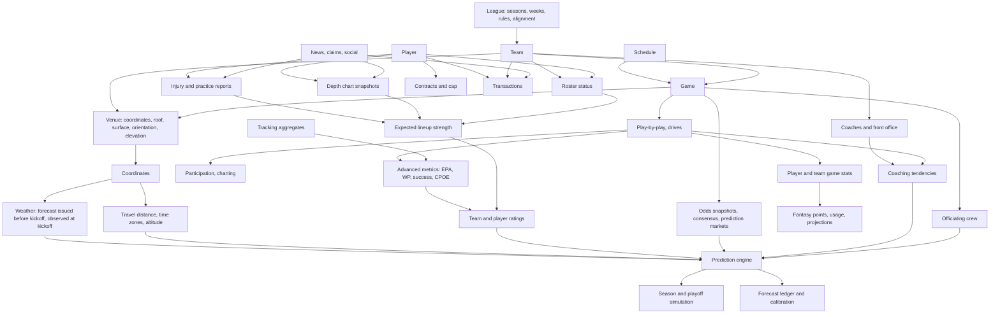

# NFL Data Architecture (recommended)

Part of the NFL data and API universe research (NU-018, Nov. 25, 2026). Index: [NFL_API_UNIVERSE.md](NFL_API_UNIVERSE.md). Which provider fills each role: [NFL_API_RECOMMENDATIONS.md](NFL_API_RECOMMENDATIONS.md) and [NFL_DATA_BACKUP_STRATEGY.md](NFL_DATA_BACKUP_STRATEGY.md).

This is a design for **extending** the data fabric that already runs (`lib/fabric/`, DEC-005), not for replacing it. Everything marked *exists* was read in the code on Nov. 25, 2026; everything marked *proposed* is a recommendation that still needs a task, tests and, where it touches `lib/contract.js` or `shared/teams.json`, the orchestrator.

## 1. What exists today

```
external source ──► adapter (lib/fabric/adapters/*.js: fetch + normalize)
                     │  wrapped by createSource (lib/fabric/source.js):
                     │  timeout, retries with backoff, circuit breaker, last-good cache on disk,
                     │  minIntervalMs (counted calls), status ok|stale|down|disabled, scope public|local
                     ▼
               assembly (lib/fabric/index.js): games, events (ts + seenAt), injuries, transactions,
               lines history, market consensus, weather, alerts, fantasy trends, media
                     ▼
               validation (lib/contract.js: validateUniverse, validatePublicSnapshot, validateGameDetail)
                     ▼
   /api/universe, /api/health, /api/game, /api/team (server.js)    data/fabric/latest.json + events/YYYY-MM-DD.json
                     ▼                                                    (public sources only, committed)
               the page (src/universe/*), the MCP server (mcp/)

build time: scripts/build.py ── nflverse games, team stats, injuries; nfelo QB values; FantasyPros QB file ──► the D blob
schedules: GitHub Actions data fetch every 3 h (and on a pushed request, DEC-023), FantasyPros daily,
           source check daily (shape drift), backup refresh daily; the claude.ai refresh daily
```

Strengths to keep: one place that calls the outside world; per-source health; carry-forward of a failed source for up to 7 days (`carry.js`); public/local scope so licensed or restricted data never reaches a committed or published file; events with both `ts` (when it happened) and `seenAt` (when we first saw it); contract checks before anything is written; no npm dependencies.

What is missing for a platform that covers the whole NFL data universe: a raw-payload archive, a canonical store with history (today each run keeps only the current state plus the event log), a player identity table, a general way to record source disagreement per field, derived-metric jobs over historical data, and a failover policy written down per field rather than implied by adapter order.

## 2. Target pipeline, stage by stage

| Stage | Responsibility | Today | Proposed increment |
|---|---|---|---|
| Fetcher | One adapter per source; conditional GET (ETag / Last-Modified) where the source supports it; budgets for counted calls | *Exists*: `createSource` with timeout, retries, breaker, `minIntervalMs` | Add conditional GET to RSS and nflverse release reads (saves bandwidth; GitHub release assets answer with ETags). Add a per-source **budget** object (calls per day or credits per month) next to `minIntervalMs`, reported in `/api/health` |
| Validation | Reject malformed payloads at the boundary | *Exists* for the assembled payload (`lib/contract.js`) and shape drift (`scripts/source-check.js`) | Add a small per-adapter shape check that runs before normalization, so a changed upstream field fails loudly in that source's status instead of producing empty data |
| Normalization | Map to canonical ids (team `a`, game `gid`, player `gsis_id`), UTC times, units | *Exists* for teams and games; players only through the nflverse roster crosswalk | A canonical `player` table (§4) built from nflverse's `players` release (CC-BY-4.0), with an unresolved-match queue |
| Deduplication | Same fact from several sources, or the same source twice | *Exists* for headlines (`clusterNews`) and events (stable `hash`) | Field-level **observations** (§5) so that two sources' values for the same fact are kept side by side, not collapsed |
| Raw storage | Keep what the source sent, when lawful, for replay and audits | *Partly*: last-good cache per source (`.cache/fabric/`, not committed, overwritten each time) | An append-only raw archive outside git (`.cache/raw/<source>/<YYYY-MM-DD>/<time>.json.gz`), kept N days, **only for sources whose terms allow storage** (§9). Never committed; never published |
| Canonical store | Entities and facts with provenance and history | *Partly*: current state in the payload; history only as events and daily snapshots | Committed JSON/JSONL stays the source of truth for public data (FEATURE_RESEARCH §6); a disposable `node:sqlite` index rebuilt from it once queries span more than ~30 days or files pass ~50 MB. A commercial product would move to PostgreSQL (§4.4) |
| Derived metrics | Computed from canonical data, versioned | *Partly*: ratings in `build.py`; injury burden; weather flags; line history | Derived-metric jobs with a `metric_version`, inputs pinned to an as-of time (no future data), outputs stored like any other fact ([NFL_DERIVED_METRICS.md](NFL_DERIVED_METRICS.md)) |
| Analytics / forecasting | Ratings, simulations, backtests | *Exists*: engine, `scripts/backtest*.py`, `scripts/evaluate.py` | Feed new factors only through the backtest gate (house rule; DEC-007) |
| AI | Grounded answers over facts with ids | Rule-based brief; MCP tools; a model waits on DEC-009 | Answers cite event or observation ids; a validator drops sentences whose ids or numbers are not in the cited facts (FEATURE_RESEARCH §6) |
| UI | Command center | *Exists* | Shows provenance, freshness and disagreement from the same fields |

### 2.1 Polling, push, queues and schedules

- **Polling** stays the default: every free or low-cost source in this research is pull-only. The fabric's heartbeat already switches between 20 seconds in a game window and 5 minutes otherwise (`startWatch`).
- **Push / WebSocket / webhooks** appear only with paid feeds (licensed live data and odds providers; see the catalog). When one is added, its adapter should still expose the same `get()` contract and write the same events, so the rest of the fabric does not care how the data arrived. A push adapter keeps a last-good state exactly like a polled one.
- **Queues**: not needed at this scale (about 30 sources, about 16 games a week). A commercial build with many paid feeds would add a small durable job queue in the database it already runs (for PostgreSQL, a table-backed queue), not a new broker.
- **Cron**: GitHub Actions (every 3 hours, plus the pushed request of DEC-023) for public snapshots; the local or hosted server for game-window polling. GitHub's scheduler can start jobs hours late or drop them (DEC-021, DEC-023): nothing time-critical may depend on it alone.
- **Rate-limit handling**: `minIntervalMs` and credit floors (The Odds API stops below 15 credits) exist. Add: honour `Retry-After` and 429 answers by opening the breaker for the stated time; read quota headers (`x-requests-remaining` is already read) into `/api/health`.
- **Retries**: `fetchWithRetry` backs off 400 ms, 800 ms. Keep retries low for live sources (a retry that arrives after the next poll is wasted) and higher for nightly files.
- **Error handling**: every failure becomes a source status, never an exception in the payload. A source that fails a whole run keeps its last good data, marked stale, for up to 7 days (`carry.js`).

### 2.2 Source failover

Today failover is implicit (for example, the ESPN scoreboard overrides the nflverse schedule locally). Proposed: one table per field family, read by the assembly step:

```
field family        order of preference (first source with fresh, valid data wins; the others are kept as observations)
game.state/score    The Odds API /scores (public, if the $30 plan is taken) → ESPN scoreboard (local scope only) → nflverse (final scores)
game.kickoff        nflverse games.csv → ESPN scoreboard (local) → our dated snapshot of the schedule
injury.status       nflverse injuries (the NFL's report) → ESPN injuries (local) → Sleeper status, labelled "Sleeper status" (owner decision)
odds.consensus      The Odds API (median no-vig across books) → a second key's books (local) → ESPN single book (local) → nflverse line
weather.forecast    Open-Meteo → NWS hourly (US) → last-good forecast marked stale
...                 (45 categories in NFL_DATA_BACKUP_STRATEGY.md, master table)
```

Rules: a source is skipped when its status is `down` or its data is older than the field's freshness budget (§6); the chosen source is recorded on the value (`source`, `at`), as games already carry `source`; when two fresh sources disagree, both are kept and a `conflict` record is written (§5).

### 2.3 Schema versioning

- The payload has `v` (1) and the forecast snapshot has a version (2, DEC-020). Keep that: a reader accepts every version it knows and says plainly when data predates a field.
- Raw archive files carry the adapter's version and the source's own version field when there is one.
- Canonical tables (§4) get a `schema_version` in a metadata file; a change ships with a migration note in `DATA_MODEL.md` and a test that reads the previous version.
- Upstream drift is detected by the daily source check (exists) and by the per-adapter shape checks (proposed).

## 3. The NFL data dependency graph



Arrows into **Prediction engine** are candidate inputs, not accepted ones: under the house rule (DEC-007) each needs an out-of-sample backtest before it changes a win probability. Today the engine uses market lines, results-based ratings, EPA, Elo and quarterback adjustments.

Relationships, written as keys (§4 defines the tables):

| From | To | Key | Cardinality | Time-dependent? |
|---|---|---|---|---|
| Player | Team | `roster_status.player_id, team` | many-to-one at a time | yes (valid from/to) |
| Player | Injury | `injury_report.player_id` | one-to-many | yes (report date) |
| Player | Depth chart | `depth_entry.player_id` | one-to-many | yes (snapshot time) |
| Player | Game | `player_game_stats (player_id, game_id)` | many-to-many | per game |
| Game | Venue | `game.venue_id` | many-to-one | per game (neutral sites) |
| Venue | Coordinates | `venue.lat, lon` | one-to-one | rarely (moves, new stadiums) |
| Coordinates | Weather | `weather_forecast (venue_id, valid_at, issued_at)` | one-to-many | yes (issue time matters) |
| Game | Officials | `game_official (game_id, official_id, position)` | one-to-many | per game |
| Game | Odds | `odds_snapshot (game_id, book, market, captured_at)` | one-to-many | yes (capture time) |
| Game | Play-by-play | `play (game_id, play_id)` | one-to-many | per game |
| Play-by-play | EPA, WP | `play.epa, play.wp` or `play_metric` | one-to-one per model version | model version |
| Play-by-play | Fantasy | via `player_game_stats` | aggregate | per game |
| Play-by-play | Prediction | via ratings and features | aggregate | as-of time |

## 4. Canonical database design

### 4.1 Conventions on every fact table

- `source_id` (a key of the source registry), `retrieved_at` (UTC, when we fetched it), `effective_at` (UTC, when it became true at the source: report time, transaction date, line time; null when unknown), `confidence` (0–1, a rule, not a judgment), `quality` (flags such as `estimated_time`, `carried`, `partial`), `raw_ref` (pointer into the raw archive, when one exists).
- **Two clocks** for anything that changes: `valid_from` / `valid_to` (when it was true in the world) and `seen_at` (when we learned it). Backtests and the time machine filter on `seen_at <= as_of` to prevent future-data leakage; the existing event record already follows this (`ts` and `seenAt`).
- Times in UTC (ISO 8601); render in the viewer's zone.
- Identifiers: our own ids are stable strings; provider ids live in crosswalk tables, never as the primary key of a fact.
- Claims are separate from facts: a news report that a player is out is a `claim` with a source; the official report is an `injury_report` row. The UI shows which is which (constitution).

### 4.2 Entities

| Table | Primary key | Main foreign keys | Key columns | Filled from (see catalog) |
|---|---|---|---|---|
| `source` | `source_id` | | label, class (official / licensed / open / unofficial / scraping), scope (public / local / licensed-internal), tier, terms URL, attribution text, usable (yes / conditions / owner decision / no), budget | the registry |
| `source_run` | `(source_id, started_at)` | source | status, records, latency, error, quota left | the fabric (exists as `runs.json`) |
| `raw_payload` | `(source_id, retrieved_at)` | source | storage path, bytes, content hash, adapter version | the raw archive (proposed) |
| `season` | `season` | | type windows (pre, regular, post), weeks, cap figure | config + official sources |
| `franchise` | `franchise_id` | | founding, history of names and cities | config |
| `team` | `team` (page abbreviation) | franchise | names, colours, conference, division | `shared/teams.json` (exists) |
| `team_season` | `(team, season)` | team, season | alignment, head coach id, venue id | config + schedule |
| `team_id_map` | `(provider, provider_id)` | team | | `shared/teams.json` (exists: nflverse, ESPN, FantasyPros, Sleeper) |
| `venue` | `venue_id` | | name, lat, lon, elevation, roof type, field azimuth, time zone, capacity | config + geodata |
| `venue_season` | `(venue_id, season)` | venue | surface, roof, renovations | config |
| `game` | `game_id` (nflverse `gid` style) | season, home, away, venue | week, game type, kickoff (UTC), neutral, network, flex flag, status, final scores | schedule sources |
| `game_id_map` | `(provider, provider_id)` | game | ESPN event id, provider game keys | adapters |
| `official` | `official_id` | | name, position, years | officiating sources |
| `game_official` | `(game_id, official_id)` | game, official | position (referee, umpire…) | officiating sources |
| `coach` | `coach_id` | | name | coaching sources |
| `coach_tenure` | `(coach_id, team, role, valid_from)` | coach, team | role (HC, OC, DC, ST, play-caller), valid_to | coaching sources |
| `player` | `player_id` (= `gsis_id` when known) | | name, birth date, position, height, weight, college, draft year/round/pick | nflverse `players` |
| `player_id_map` | `(provider, provider_id)` | player | ESPN, Sleeper, PFR, PFF, Yahoo, OTC, FantasyPros… ids; `match_method`, `confidence` | nflverse crosswalk + manual overrides |
| `player_alias` | `(player_id, alias)` | player | name variants, suffixes | crosswalk + news matching |
| `unresolved_match` | `(source_id, provider_id)` | source | raw name, team, candidates, first seen | adapters (never silently merged) |
| `roster_status` | `(player_id, team, valid_from)` | player, team | status (active, reserve/IR, PUP, practice squad, suspended…), valid_to, seen_at | rosters, transactions |
| `depth_snapshot` | `(team, captured_at, source_id)` | team, source | snapshot time at source | depth-chart sources |
| `depth_entry` | `(team, captured_at, source_id, slot, rank)` | depth_snapshot, player | position group, slot, rank | depth-chart sources |
| `injury_report` | `(player_id, report_date, source_id)` | player, game | practice status (DNP/LP/FP), game status (O/D/Q), body part, type, seen_at | official report and mirrors |
| `transaction` | `transaction_id` (hash) | player, team | kind (signed, released, waived, claimed, IR, activated, elevated, traded, tag, extension, retired, suspended), effective date, seen_at, text | transaction sources |
| `contract` | `contract_id` | player, team | years, value, guarantees, APY, signed date | contract sources |
| `cap_snapshot` | `(team, season, captured_at)` | team | cap space, top-51 figures | contract sources |
| `drive` | `(game_id, drive_id)` | game | team, start/end, result | play-by-play |
| `play` | `(game_id, play_id)` | game, drive | quarter, clock, down, distance, yard line, type, description, players (ids), score, flags (penalty, challenge, turnover…) | play-by-play |
| `play_participation` | `(game_id, play_id)` | play | formation, personnel, box count, rushers, coverage, motion, play action, RPO | charting / participation sources |
| `play_metric` | `(game_id, play_id, metric, model_version)` | play | value (EPA, WP, CP, xYAC…) | computed or provided |
| `player_game_stats` | `(player_id, game_id, source_id)` | player, game | box score, snaps, routes, targets, air yards | stats sources |
| `team_game_stats` | `(team, game_id, source_id)` | team, game | box score, EPA aggregates | stats sources |
| `metric_value` | `(entity_type, entity_id, metric, window, as_of, metric_version)` | | value, sample size, inputs hash | derived jobs |
| `weather_station` | `station_id` (ICAO) | | lat, lon, elevation | station metadata |
| `weather_forecast` | `(venue_id, valid_at, issued_at, source_id, model)` | venue | temperature, wind speed, gust, direction, precipitation, probability, snow | weather sources |
| `weather_observation` | `(station_id, observed_at, source_id)` | station | the same fields, observed | observation sources |
| `weather_alert` | `(alert_id)` | venue | event, severity, onset, expires | NWS (exists) |
| `odds_snapshot` | `(game_id, book, market, line, captured_at, source_id)` | game | price, side, open flag, last update at the book | odds sources |
| `market_consensus` | `(game_id, market, captured_at)` | game | median line, no-vig probability, books counted | computed (exists for The Odds API) |
| `prediction_market_price` | `(market_id, captured_at, source_id)` | game | contract, price, volume | prediction-market sources |
| `fantasy_projection` | `(player_id, season, week, scoring, source_id, issued_at)` | player | points, stat lines | fantasy sources |
| `fantasy_rank` / `adp` | `(player_id, format, source_id, issued_at)` | player | rank, ADP, spread | fantasy sources |
| `news_item` | `news_id` (hash of URL) | source | headline, URL, publisher, published_at, seen_at, teams, players | feeds (exists as events) |
| `claim` | `claim_id` | news_item, player, team | kind (injury, transaction, lineup…), status (reported / confirmed / contradicted), confidence | extracted from news (proposed) |
| `media_item` | `media_id` | source, team | official video or episode, embeddable, published_at | media sources (exists) |
| `forecast` | `(model_version, made_at, target)` | game or team | probability, inputs hash; frozen before kickoff | the engine and snapshots |
| `forecast_outcome` | `(model_version, made_at, target)` | forecast | outcome, Brier, log loss | computed after games |
| `observation` | `(entity_type, entity_id, field, source_id, seen_at)` | source | value, effective_at, confidence | every adapter (§5) |
| `conflict` | `(entity_type, entity_id, field, opened_at)` | | values by source, resolution, closed_at | computed (§5) |

### 4.3 Where it lives (this project)

- Public facts stay committed JSON/JSONL under `data/` (snapshot, events, run report), validated by `lib/contract.js`. Partition long histories by season and week (for example `data/history/odds/2026/w12.jsonl`) so no single file grows without bound.
- A disposable `node:sqlite` index (built into Node 24.15+, Release Candidate; FTS5 works, checked Nov. 23 in FEATURE_RESEARCH §6) rebuilt from those files when cross-week queries are needed. It is never the source of truth and never committed.
- Large historical inputs (play-by-play since 1999 and the like) are read from nflverse release files at build or job time, not mirrored into git.
- Licensed or restricted data (ESPN JSON, per-book prices, FantasyPros raw answers, anything under a paid licence) stays in the local scope or in a non-public store, as today.

### 4.4 Where it would live (commercial product)

PostgreSQL as the canonical store (the tables above map one to one), with time partitioning on `odds_snapshot`, `play`, `weather_forecast` and `observation`; object storage for the raw archive with lifecycle expiry set per source's storage terms; read models (materialised views) for the page. Recorded here as the scale-up path only; DEC-001 keeps the current stack until the interface or data volume outgrows it.

## 5. Provenance, disagreement and identity

- **Observations.** Every adapter writes what it saw as observations: `(entity, field, value, source, seen_at, effective_at, confidence)`. The assembly step chooses a display value per field with the failover order (§2.2) and keeps the rest.
- **Conflicts.** When two fresh, independent observations of the same field differ (an injury status, a kickoff time, a line), a `conflict` is opened with both values and closed when they agree or an authoritative source settles it. The page shows "sources disagree" with both values, as the injury-report comparison already does for ESPN and nflverse. Example seen on Nov. 22: ESPN and nflverse disagreed on two kickoff times; ESPN was right (CURRENT_STATE).
- **Authority order** is per field, not per source: the league's own report outranks a fantasy app for injury designations, but a fantasy app may be faster; speed and authority are both recorded.
- **Identity.** Teams: `shared/teams.json` (exists). Games: nflverse `game_id`, with provider ids in `game_id_map`, matched on season, week, away and home (exists). Players: nflverse's `players` release carries GSIS, ESPN, Sleeper, PFR, PFF, Yahoo and other ids under CC-BY-4.0 (FEATURE_RESEARCH §5), which replaces the GPL DynastyProcess file as the base crosswalk. Name matching is a last resort, done only within one team and position, never across teams, and every name match is written with `match_method: "name"` and a lower confidence. Anything ambiguous goes to `unresolved_match` and is counted, never guessed (the fantasy block already does this).

## 6. Data freshness (recommended refresh intervals)

Intervals assume the free and low-cost sources recommended in [NFL_API_RECOMMENDATIONS.md](NFL_API_RECOMMENDATIONS.md); "budget" means a paid or counted source where the interval is set by credits, not by need. Event-specific timings (injury-report and inactive deadlines, flex announcements) are taken from the track reports and cited there.

| Data | Off-season | In season, weekday | Game day, before kickoff | During games | Today in the fabric |
|---|---|---|---|---|---|
| Schedule, kickoffs, networks | daily | daily; hourly in the days after a flex announcement | hourly | per live source | nflverse games every 30 min (TTL) |
| Live scores, game state | none | none | 5 min until 15 min before kickoff | 15–20 s (licensed feeds push) | ESPN scoreboard 15 s TTL, heartbeat 20 s (local only) |
| Live play-by-play | none | none | none | 10–20 s | ESPN summary 15 s on demand (local only) |
| Final box scores and play-by-play (nflverse) | weekly | nightly, and the morning after each game day | | | nflverse team stats at build |
| Injury reports | weekly | every 15–30 min around the daily report release, otherwise every 3 h | every 15 min, every 2–5 min around the inactive list | 5 min (in-game injuries come from live feeds and news) | nflverse injuries 3 h; ESPN injuries 30 min (local) |
| Rosters and depth charts | daily | daily, plus a re-read when a transaction for that team arrives | every 2 h | none | nflverse depth and rosters 12 h |
| Transactions | daily | every 30 min in business hours; every 5–10 min on cut-down day and at the trade deadline | 30 min | none | ESPN transactions 30 min (local) |
| Weather forecast | none | every 6 h for games within 7 days | hourly from 48 h out; every 15–30 min in the last 6 h | 15 min for outdoor games | Open-Meteo 30 min |
| Weather alerts | none | 30 min for games within 2 days | 15 min | 15 min | NWS 30 min |
| Odds (pre-game) | weekly (futures) | budget: 2–3 looks a day on a free tier; 5–15 min on a paid tier | budget: 1–5 min on a paid tier | seconds (paid live feeds only) | The Odds API every 11 h (free-tier credits) |
| Prediction-market prices | daily | hourly | 5 min | 1 min | not wired |
| News headlines | 30 min | 5–10 min with conditional GET | 5 min | 5 min | RSS 10 min, ESPN news 5 min (local) |
| Fantasy projections and rankings | weekly | daily | every 2–3 h | none | FantasyPros daily (one call) |
| Fantasy trends | daily | hourly | hourly | none | Sleeper 1 h |
| Official video and podcasts | daily | 30 min (video), 6 h (podcasts) | 30 min | 30 min | as stated |
| Officials | per season | weekly once assignments are known | | | not wired |
| Venue facts (roof, surface, orientation) | each season and on change | | per-game roof state if a source exists | | config |
| Historical statistics | nightly | nightly | | | at build |

Every value carries its age, and the page labels anything older than its budget as stale (exists for sources; proposed per field).

## 7. Security

What exists and must be kept:
- Keys only in environment variables and GitHub secrets (`ODDS_API_KEY`, `FANTASYPROS_API_KEY`); never in the repository, a URL, a log, a cache file or a payload. The Odds API key travels in a header and is scrubbed from error text (DEC-019, tested).
- Server-side calls only: the page never calls a third party for data (DEC-005); it reads `/api/universe` or the embedded snapshot.
- Page Content-Security-Policy with inline scripts by hash and a short allowlist (F31; DEC-022 adds only `https://www.youtube.com`).
- Request cap per client on the API (`RATE_LIMIT`), Host-header check, localhost binding by default, `/api/live` off without the local scope (DEC-018).
- No open proxy: no endpoint or MCP tool fetches a URL the caller supplies (MCP_ARCHITECTURE), which also closes server-side request forgery.
- Scope separation: data from sources whose terms forbid publication stays local, and the public-snapshot validator refuses it.

Proposed additions:
- A **budget guard** per keyed source: hard monthly ceilings in code, not only in the provider's dashboard, so a loop cannot burn a paid quota.
- **Least-privilege tokens**: fine-grained GitHub tokens for the refresh push (DEC-023), separate keys per environment (local, GitHub, hosted), and rotation dates recorded next to each secret's name in the docs (names only, never values).
- **Cache as a shield**: the public site answers from the snapshot and cache; a burst of visitors never multiplies upstream calls (exists through TTLs; keep it true for every new source).
- **Abuse prevention** on the hosted server: keep the per-client cap; add a global cap on expensive routes (`/api/game` triggers upstream reads in the local scope).
- **Untrusted text**: headlines, social posts and transcripts are data. They never reach a prompt without being marked untrusted, and model output is validated against cited ids (FEATURE_RESEARCH §6).
- **Personal data**: collect none. If league connections (Sleeper, Yahoo, ESPN) are ever added, ids and tokens stay in local environment variables and never in committed files (CURRENT_STATE owner decision 4).

## 8. Licensing-aware data flow

Every source in the registry has a `scope` and a "usable" verdict. Proposed rule for the assembly step: a value from a source whose verdict is not *Yes* or *Conditions* may appear only in the local scope; a value from a *Conditions* source carries its attribution string, which the page renders next to it (DEC-013 extended from per-panel to per-field). New sources enter the public payload only after their registry row is filled.

## 9. Raw-payload retention by source class

| Class | Keep raw? | Where | How long |
|---|---|---|---|
| Open data (nflverse CC-BY, NWS, Wikidata CC0, OpenStreetMap ODbL) | Yes | local archive; may be committed if small and attributed | indefinitely (ODbL: share-alike on derived databases) |
| Keyed free tiers with storage allowed (The Odds API, Open-Meteo non-commercial) | Yes | local archive only | per terms; The Odds API allows storing in an app, not re-serving |
| Personal-use or non-commercial keys (FantasyPros) | Only the derived file | never committed raw (exists) | per terms |
| Unofficial endpoints (ESPN JSON) | No archive beyond the last-good cache | local only | overwritten |
| Scraping-only sites | Not collected | | |
